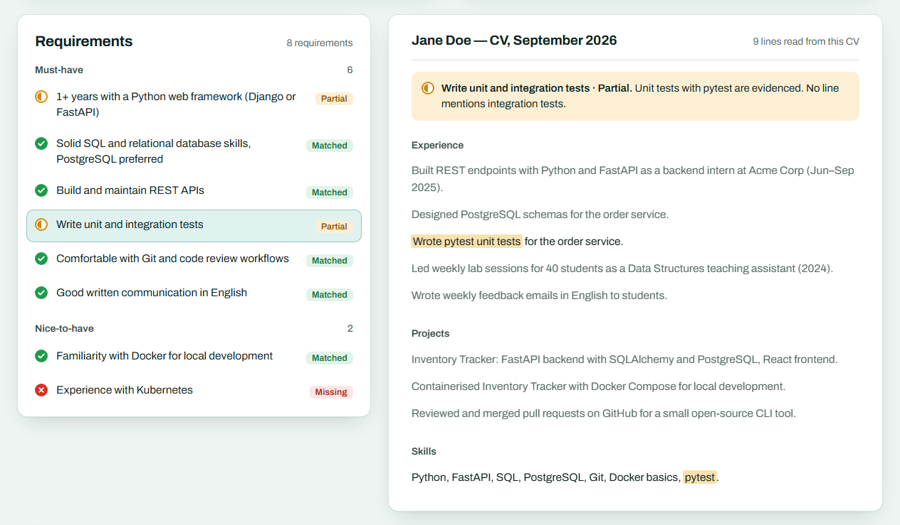
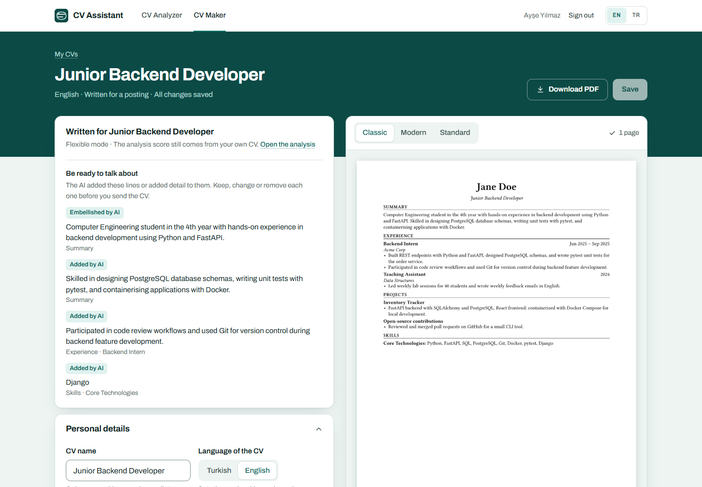

# CV Assistant

A web and Android app that compares a CV with a job posting and shows, requirement by requirement, which CV lines support it, what is missing, and what to change before applying. On the web, a CV Maker turns the CV into an editable document and can write a version of it for the posting. Built for students and early-career candidates, in English and Turkish.

Instead of an unexplained "87% fit", every judgement points at the CV lines it relied on, unsupported claims are marked missing instead of trusted, and the score comes from a stated formula computed by code, not by the model.

**Live demo:** [cvassistant-app.vercel.app](https://cvassistant-app.vercel.app) opens the sample result without an account. Register (a six-digit code sent by email confirms the address) to run the fictional sample CV and posting live. The API runs on a free tier that sleeps when idle, so the first request after a quiet spell can take about a minute, and an analysis can take a couple of minutes when the free AI models are busy.






<p>
  
  
  
</p>

<details>
<summary>More screens</summary>


</details>

## What it does

1. Paste or upload a CV (PDF or Word .docx; clickable links such as project repositories are read too) and paste a job posting, or fill the posting from its link (LinkedIn jobs and posts, Kariyer.net, Youthall and other pages with job data); on Android, share the link from the LinkedIn or Kariyer.net app.
2. The posting's requirements are extracted and labelled must-have or nice-to-have.
3. Each requirement is matched against the CV's own lines and judged **matched**, **partial** or **missing**, with the lines quoted.
4. A score is computed from those labels (must-have counts double), with the formula shown next to it.
5. The result leads with **what to fix**: prioritized changes tied to a requirement and a CV section.
6. Interview questions are generated on request, aimed at the gaps.
7. A result can be printed or saved as PDF from the web: a plain document with the score, the fixes and, for every requirement, the reason and the CV lines it relied on.
8. **CV Maker** (web): a saved CV is copied into an editable CV, or a new one starts from a blank page. Three print templates (Classic, Modern, Standard) render to PDF on the server, with a live preview beside the form.
9. **A CV for a posting:** from a result, the AI writes a version of the CV for that posting, in the posting's language. Every line it wrote or changed stays marked in the editor, and the analysis score does not change.

AI-written text follows the interface language (English or Turkish); requirement wording and CV quotes stay in their source language. Both clients use the same API, and the account remembers the language across devices.

## How the analysis works

```text
job posting ──► extract requirements (LLM, validated JSON) ──┐
CV ───────────► extract evidence lines (LLM, copied verbatim) ┤
                                                               ▼
        embed both sides in one call ──► hybrid retrieval per requirement:
                                         3 closest by meaning (cosine) + up to 2 by shared words (BM25)
                                                               ▼
        grounded judgement (LLM): matched / partial / missing, citing retrieved line ids
                                                               ▼
        grounding guard (code): a match that cites no retrieved line becomes "missing"
                                                               ▼
        score (code): must-have ×2, nice-to-have ×1; matched 1, partial 0.5, missing 0
                                                               ▼
        summary + prioritized fixes (LLM) ──► interview questions on request (LLM)
```

- **Prompts are Markdown files** (`services/api/app/ai/prompts/`) with explicit input tags, output schema, rules and an output-language parameter; every model answer is validated against a Pydantic schema.
- **Hybrid retrieval** exists because pure embedding search missed a literal match: for "3rd or 4th-year student", the CV line "Industrial Engineering, 3rd-year student" ranked last of seven by cosine similarity. BM25 over the CV's own lines (a few dozen hand-written lines, words cut to five letters so Turkish suffixes match) brings it back.
- **Provider abstraction:** a Gemini implementation and a deterministic fake for tests. Free-tier quotas are per model, so requests run through a fallback chain ordered by measured reliability.
- **No vector database:** a CV has 5 to 25 evidence lines and embeddings are only needed during one run, so vectors are compared in memory and never stored.

## How a CV is written for a posting

```text
saved CV ──► structure into fields (LLM, validated JSON) ──► fact check (code): employers, schools, roles,
                                                              degrees and years must appear in the CV text
                                                                       ▼
                         editable CV document (JSON) ──► live preview and PDF (Typst, three templates)

analysis + CV document ──► tailor (LLM): text only, written into slots referenced by id
                                                                       ▼
        assemble (code): employers, schools, dates, links and project names copied from the source CV
                                                                       ▼
        origin per line: from your CV / reworded / embellished by AI / added by AI
```

- **The model writes text, code copies facts.** The tailoring output has no field for an employer, a school or a date, so it cannot invent one; code takes them from the user's CV. A line the model claims to have copied but that is not in the source is relabelled.
- **Origins stay visible.** Every line the model touched keeps its mark in the editor and appears in a "be ready to talk about" list. The PDF carries no labels.
- **Two modes.** Flexible (the default) may write the summary and skills freely and lightly embellish projects and experience; strict keeps only the user's own lines and asks yes/no questions instead.
- **The score does not move.** The analysis is always computed from the user's own CV, never from generated content.
- **The import is checked too.** Names and years the CV text does not show are reported, and a section the model calls "not carried over" is dropped from that note when the section was in fact filled.

## Evaluation

Five hand-labelled cases (`services/api/app/ai/eval/cases/`): a good-fit backend intern, a partial-fit mobile developer, a weak-fit ML engineer, a Turkish data-analyst internship with Turkish output, and a Turkish frontend internship that asks for a GitHub link. `python -m app.ai.eval.run_eval --provider gemini` reports:

| Metric | What it checks | Latest real run (Gemini free tier) |
|---|---|---|
| Structured-output validity | every step returned schema-valid JSON | 1.0 |
| Requirement keyword recall | the expected requirements were extracted | 1.0 |
| Status accuracy | matched / partial / missing against hand labels | 1.0 |
| Importance accuracy | must-have vs nice-to-have | 1.0 |
| Grounded rate | cited quotes appear verbatim in the CV | 1.0 |
| Language match | generated text is in the requested language | 1.0 |
| No internal ids | generated text cites the CV by content, never as "e2" or "r3" | 1.0 |

Five cases are a smoke check, not a benchmark, and model output is not deterministic. The set earns its keep by catching regressions: the Turkish case exposed the retrieval miss above (status accuracy 0.83 on that case) before hybrid retrieval fixed it, and the GitHub case guards a fix for links: a real CV's GitHub link was judged missing because the prompt had no "link" evidence type and the project links sat behind PDF icons that text extraction does not return.

Tailoring has its own run (`python -m app.ai.eval.run_tailor_eval --provider gemini`): each case is structured, analysed and tailored in both modes, and the Turkish CVs are also written for English postings, 12 runs in all.

| Metric | What it checks | Latest real run |
|---|---|---|
| Validity | the answer fit the schema and could be assembled into a CV | 1.0 |
| Invented entities | employers, schools, dates, project or certificate names that are not in the source CV | 0 |
| Posting keywords | share of the posting's keywords the CV contains, before → after | 0.563 → 0.647 |
| Added share | lines the model added or embellished, flexible / strict | 0.345 / 0 |
| Language match | the CV is written in the posting's language | 1.0 |
| One page | the PDF fits on one page | 12 / 12 |

## Architecture

One shared backend, two independent clients; domain rules live only in the API.

```text
apps/web        Next.js 16 / TypeScript web client (server-side API calls, token in an httpOnly cookie)
apps/mobile     Flutter / Dart Android client (token in Android Keystore-backed secure storage)
services/api    FastAPI backend: auth, documents, AI pipeline, persistence
```

- **Backend:** Python 3.12+, FastAPI, SQLAlchemy 2, Alembic, PostgreSQL. Analyses run as background tasks; clients poll until they finish (the mobile app pauses polling in the background).
- **AI:** Google Gemini free tier for structured LLM output and embeddings, behind a provider interface.
- **Auth:** email/password with bcrypt and JWT bearer tokens; every query is scoped to the signed-in user. A new account confirms its address with a six-digit code sent through Brevo; analyses, interview questions and AI-written CVs wait until it does.
- **Abuse limits:** the shared free AI quota is the only real cost, so all AI actions share a daily budget counted in PostgreSQL (it survives the free instance restarting), and accounts and AI actions are also limited per network address. Addresses are stored only as keyed hashes.
- **CV documents:** stored as validated JSON on one row per CV. PDFs, page previews and list thumbnails are typeset on the server with Typst: one cached compiler per template and bundled open fonts only, so the output does not depend on the machine.
- **Design:** one visual system for both clients (a deep teal brand band, white cards on a pale teal ground, green / amber / red for matched / partial / missing). Status is also carried by the icon's shape (check, half disc, cross), never by colour alone.

## Key decisions

- **The model labels, code scores.** The LLM decides matched / partial / missing with citations; the number is a deterministic weighted percentage, so the same labels always give the same score and the formula can be shown.
- **Results stored as validated JSON** on the analysis row instead of normalized requirement tables: nothing queries across analyses yet, and the Pydantic model is the contract.
- **Background task + polling** instead of a queue or websockets: one instance on a free tier does not need more.
- **Output language stored per analysis,** so a result never changes language after a settings switch and one page never mixes languages.
- **No shared demo account:** a public pre-computed sample result, and after registering one tap fills the form with a fictional sample CV and posting.
- **A code, not a link, for email verification:** the same six digits work in the browser and in the Android app, without deep links. Codes are stored as keyed hashes, expire after 15 minutes and allow five wrong guesses.
- **Which address a limit counts:** the API sits behind Cloudflare, so it uses `CF-Connecting-IP`, which a caller cannot set; a caller's own `X-Forwarded-For` would stay in front. The web server calls the API for its visitors and forwards the visitor's address, which the API accepts only with a secret both servers share.
- **Typst for PDFs:** a small native Python wheel with no TeX installation; the CV goes in as JSON, and the same renderer draws the PDF, the live preview and the list thumbnails.

## Local setup (backend)

Requirements: Git, Python 3.12+, Docker.

```bash
# 0. Clone
git clone https://github.com/ahmetyasinaltun/cv-assistant.git
cd cv-assistant

# 1. Start PostgreSQL (listens on localhost:5434 to avoid clashing with a local install)
docker compose up -d

# 2. Create a virtualenv and install the API
cd services/api
python -m venv .venv
.venv/Scripts/activate            # Windows
# source .venv/bin/activate       # macOS / Linux
pip install -e ".[dev]"

# 3. Configure environment
cp .env.example .env              # Windows cmd: copy; then set JWT_SECRET_KEY and GEMINI_API_KEY
                                  # EMAIL_PROVIDER=log writes verification codes to the API log

# 4. Apply migrations and run
alembic upgrade head
uvicorn app.main:app --reload
```

API docs: http://localhost:8000/docs

## Local setup (web)

Requirements: Node.js 20+.

```bash
# Start the backend first (see above); the web client talks to it at http://localhost:8000
cd apps/web
npm install
npm run dev            # http://localhost:3000 → redirects to /en or /tr
```

The web client is a Next.js 16 app (App Router, TypeScript, Tailwind CSS 4). The interface is bilingual (English/Turkish): the language lives in the URL (`/en/...`, `/tr/...`) and the first visit picks it from the browser.

- Register at `/en/register`; with `EMAIL_PROVIDER=log` the verification code appears in the API's log. Then start an analysis from **New analysis**. "Fill with the sample CV and posting" runs the fictional sample live.
- The session token lives in an httpOnly cookie and every API call is made by the Next.js server, so the browser never sees the token. Set `API_BASE_URL` in `apps/web/.env.local` if the API is not on `http://localhost:8000` (see `.env.example`).
- The CV Maker is at `/en/cvs`. A completed analysis offers **Write a CV for this posting** in its header.
- Without an account, the pre-computed sample result is at `/en/analyses/sample`. Add `?preview=running`, `failed`, `no-questions` or `questions-error` to see the other states.

## Local setup (mobile)

Requirements: Flutter 3.47 (stable) and the Android SDK. The mobile client is Android-first; it calls the same API as the web client.

```bash
# Start the backend first (see above)
cd apps/mobile
flutter pub get
flutter run            # Android emulator; the API is reached at http://10.0.2.2:8000
flutter run --dart-define=API_BASE_URL=http://192.168.1.20:8000   # a phone on the same network
```

- The access token is kept in `flutter_secure_storage` (encrypted with a key in the Android Keystore).
- The app opens in the device language until sign-in, then in the account's language; changing the language while signed in saves it to the account, as on the web.
- Debug builds allow plain HTTP for the local API; release builds allow HTTPS only.

## Tests

```bash
cd services/api
pytest

cd apps/web
npm test               # unit tests (Vitest)
npm run lint
npm run build          # also type-checks

cd apps/mobile
flutter analyze
flutter test           # unit and widget tests against a scripted fake API
```

Backend tests run against an in-memory SQLite database and a deterministic fake AI provider, so they need no network access or API keys.

## Deployment

The demo runs on three free services in Frankfurt (EU), none of which needs a credit card:

| Part | Host | Free-tier behaviour |
|---|---|---|
| PostgreSQL | [Neon](https://neon.com) | 0.5 GB; compute sleeps after 5 minutes idle and wakes on the next query |
| API (FastAPI) | [Render](https://render.com) web service | sleeps after 15 minutes without requests; the first request then takes about a minute |
| Web (Next.js) | [Vercel](https://vercel.com) Hobby | personal, non-commercial use |

1. **Neon:** create a project in AWS Europe Central 1 (Frankfurt) and copy the **direct** connection string (connection pooling off; PgBouncer in transaction mode does not suit a long-running server with prepared statements).
2. **Render:** New → Blueprint, pick this repository; Render reads `render.yaml`. Enter `DATABASE_URL` (the Neon string, unchanged), `GEMINI_API_KEY` (from [Google AI Studio](https://aistudio.google.com/apikey)), `BREVO_API_KEY` and `EMAIL_SENDER_ADDRESS` (a sender verified in Brevo) and `WEB_PROXY_SECRET` (a random value of at least 32 characters); Render generates `JWT_SECRET_KEY`. The start command runs `alembic upgrade head` first, and the API refuses to start in production with a development secret, without a Gemini key, without the email service or without the proxy secret. `https://<service>.onrender.com/health` should answer `{"status":"ok"}`.
3. **Vercel:** import the repository with Root Directory `apps/web`, set `API_BASE_URL` to the Render address (no trailing slash) and `API_PROXY_SECRET` to the same value as the API's `WEB_PROXY_SECRET`.
4. **Android:** `flutter build apk --release --dart-define=API_BASE_URL=https://<service>.onrender.com` (signed with the template's debug key: fine for sideloading a demo, not for the Play Store).

Pushing to `main` redeploys the API and the web; schema changes ship as Alembic migrations and run on the next API start.

The **Live site** workflow (`.github/workflows/live-site.yml`) pauses or resumes the web and the API together: Actions → Live site → Run workflow with `pause` or `resume`, or `gh workflow run live-site.yml -f action=pause`. It needs the repository secrets `RENDER_API_KEY` and `VERCEL_TOKEN`. Data in Neon is not touched.

## Known limitations

- **Free AI tier and personal data.** The default provider is Gemini's free tier. Under Google's terms for unpaid services, submitted content may be used to improve Google's products and may be read by human reviewers. Use fictional or anonymized CVs for demos; a paid tier or a self-hosted model would be needed for real personal data.
- **Speed depends on the free tier.** An analysis takes from a few seconds to a few minutes, depending on which models in the fallback chain are overloaded or out of quota.
- **Security is portfolio-grade.** Passwords are hashed with bcrypt (at most 72 bytes, which bcrypt reads), the web client keeps the token in an httpOnly cookie and sends anti-framing and nosniff headers, the API refuses bodies over 6 MB and hides its schema pages in production. Per-account limits (10 failed sign-ins per email in 15 minutes; 20 analyses, 20 question sets and 10 AI-written CVs per user a day; 30 link reads per user an hour) are counted in memory, so they reset when the single free instance restarts; the service-wide AI budget (150 actions a day) and the per-address limits (5 accounts and 40 AI actions a day) are counted in the database. Email verification raises the cost of fake accounts but does not stop them: disposable addresses exist, which is why the daily budget, not verification, is the hard ceiling. There are no refresh tokens or audit logs. The last security pass (pip-audit, npm audit, bandit and a manual review) found no vulnerable runtime dependency; it added a test that every route taking an id answers 404 to another account, and a refusal of Word files whose XML declares entities.
- **The CV Maker is on the web only.** The Android app covers analyses; CV documents are not on mobile yet.
- **Verification emails come from a free sender.** Without a domain of its own, Brevo cannot sign the mail for its sender address, so codes may land in the spam folder; the code screen says so.
- **Mobile is Android only and was verified on an emulator.** iOS would need a Mac to build; PDF picking and gestures still need a pass on a real phone.
- **Filling a posting from a link depends on the site.** The server reads one public page per request, the way a link preview does: schema.org `JobPosting` data first, then known layouts (LinkedIn jobs and posts, Kariyer.net), then the page's main text. Sites behind bot protection (Indeed, Glassdoor and Yenibiriş behind Cloudflare; Kariyer.net behind PerimeterX, which refuses after a few requests) are not worked around: the user is told so and pastes the text. Private and internal addresses are refused on every redirect hop, and the address actually connected to is checked again before the response is used; the connection is not pinned to the checked address, so under DNS rebinding a request can still reach an internal address, but its answer is discarded.
- **CV and posting language is not detected.** Only AI-written text is tagged with a language; source text inherits the interface language for screen readers.
