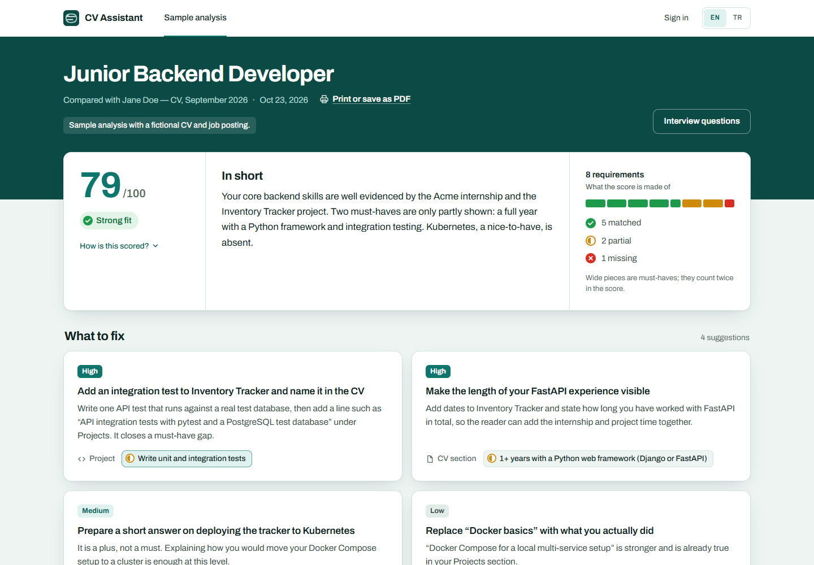
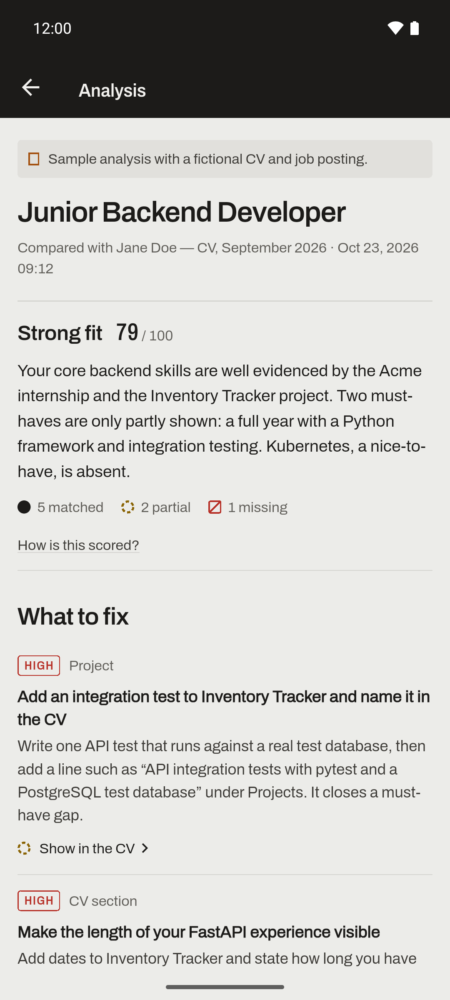
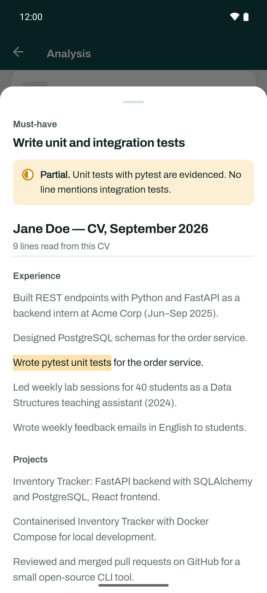
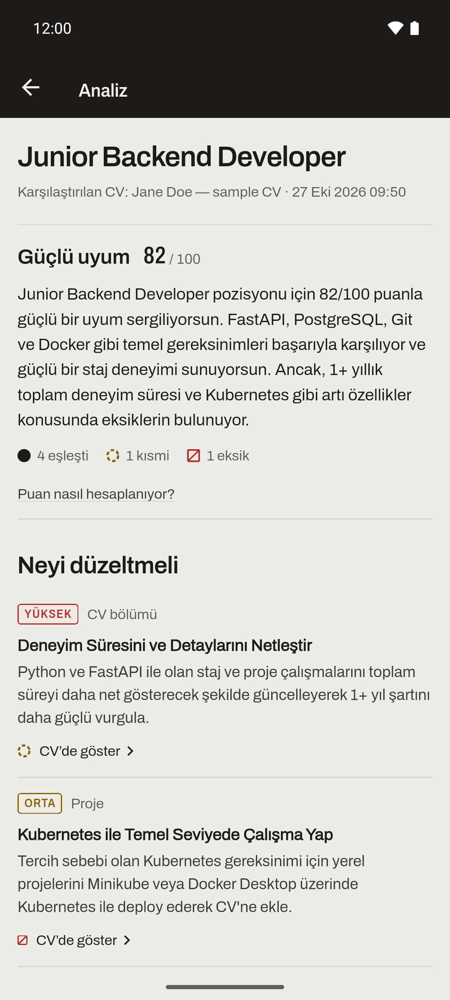
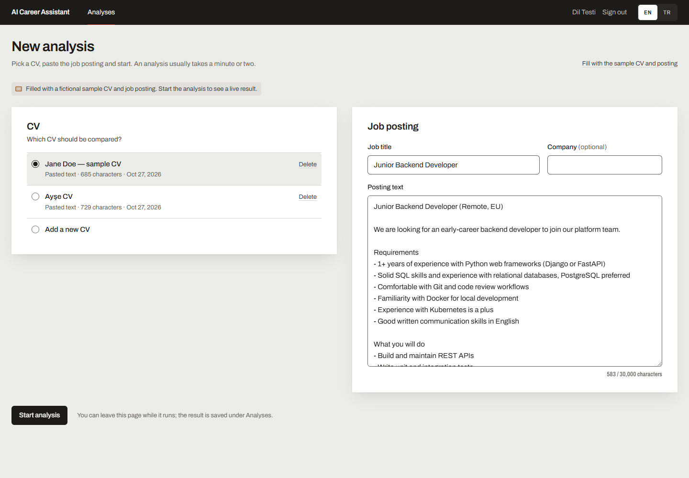

# AI Career Assistant

A web and Android app that compares a CV with a job posting and shows, requirement by requirement, which CV lines support it, what is missing, and what to change before applying. Built for students and early-career candidates, in English and Turkish.

Instead of an unexplained "87% fit", every judgement points at the CV lines it relied on, unsupported claims are marked missing instead of trusted, and the score comes from a stated formula computed by code, not by the model.

**Live demo:** [ai-career-assistant-seven-delta.vercel.app](https://ai-career-assistant-seven-delta.vercel.app) opens the sample result without an account. Register to run the fictional sample CV and posting live. The API runs on a free tier that sleeps when idle, so the first request after a quiet spell can take about a minute, and an analysis can take a couple of minutes when the free AI models are busy.



<p>
  
  
  
</p>

<details>
<summary>More screens</summary>



</details>

## What it does

1. Paste or upload a CV (PDF; clickable links such as project repositories are read too) and paste a job posting.
2. The posting's requirements are extracted and labelled must-have or nice-to-have.
3. Each requirement is matched against the CV's own lines and judged **matched**, **partial** or **missing**, with the lines quoted.
4. A score is computed from those labels (must-have counts double), with the formula shown next to it.
5. The result leads with **what to fix**: prioritized changes tied to a requirement and a CV section.
6. Interview questions are generated on request, aimed at the gaps.

AI-written text follows the interface language (English or Turkish); requirement wording and CV quotes stay in their source language. Both clients use the same API, and the account remembers the language across devices.

## How the analysis works

```text
job posting ──► extract requirements (LLM, validated JSON) ──┐
CV ───────────► extract evidence lines (LLM, copied verbatim) ┤
                                                               ▼
        embed both sides in one call ──► hybrid retrieval per requirement:
                                         3 closest by meaning (cosine) + up to 2 by shared words (BM25)
                                                               ▼
        grounded judgement (LLM): matched / partial / missing, citing retrieved line ids
                                                               ▼
        grounding guard (code): a match that cites no retrieved line becomes "missing"
                                                               ▼
        score (code): must-have ×2, nice-to-have ×1; matched 1, partial 0.5, missing 0
                                                               ▼
        summary + prioritized fixes (LLM) ──► interview questions on request (LLM)
```

- **Prompts are Markdown files** (`services/api/app/ai/prompts/`) with explicit input tags, output schema, rules and an output-language parameter; every model answer is validated against a Pydantic schema.
- **Hybrid retrieval** exists because pure embedding search missed a literal match: for "3rd or 4th-year student", the CV line "Industrial Engineering, 3rd-year student" ranked last of seven by cosine similarity. BM25 over the CV's own lines (a few dozen hand-written lines, words cut to five letters so Turkish suffixes match) brings it back.
- **Provider abstraction:** a Gemini implementation and a deterministic fake for tests. Free-tier quotas are per model, so requests run through a fallback chain ordered by measured reliability.
- **No vector database:** a CV has 5 to 25 evidence lines and embeddings are only needed during one run, so vectors are compared in memory and never stored.

## Evaluation

Five hand-labelled cases (`services/api/app/ai/eval/cases/`): a good-fit backend intern, a partial-fit mobile developer, a weak-fit ML engineer, a Turkish data-analyst internship with Turkish output, and a Turkish frontend internship that asks for a GitHub link. `python -m app.ai.eval.run_eval --provider gemini` reports:

| Metric | What it checks | Latest real run (Gemini free tier) |
|---|---|---|
| Structured-output validity | every step returned schema-valid JSON | 1.0 |
| Requirement keyword recall | the expected requirements were extracted | 1.0 |
| Status accuracy | matched / partial / missing against hand labels | 1.0 |
| Importance accuracy | must-have vs nice-to-have | 1.0 |
| Grounded rate | cited quotes appear verbatim in the CV | 1.0 |
| Language match | generated text is in the requested language | 1.0 |

Five cases are a smoke check, not a benchmark, and model output is not deterministic. The set earns its keep by catching regressions: the Turkish case exposed the retrieval miss above (status accuracy 0.83 on that case) before hybrid retrieval fixed it, and the GitHub case guards a fix for links: a real CV's GitHub link was judged missing because the prompt had no "link" evidence type and the project links sat behind PDF icons that text extraction does not return.

## Architecture

One shared backend, two independent clients; domain rules live only in the API.

```text
apps/web        Next.js 16 / TypeScript web client (server-side API calls, token in an httpOnly cookie)
apps/mobile     Flutter / Dart Android client (token in Android Keystore-backed secure storage)
services/api    FastAPI backend: auth, documents, AI pipeline, persistence
```

- **Backend:** Python 3.12+, FastAPI, SQLAlchemy 2, Alembic, PostgreSQL. Analyses run as background tasks; clients poll until they finish (the mobile app pauses polling in the background).
- **AI:** Google Gemini free tier for structured LLM output and embeddings, behind a provider interface.
- **Auth:** email/password with bcrypt and JWT bearer tokens; every query is scoped to the signed-in user.
- **Design:** one visual system for both clients ("the editor's contact sheet": paper on a light table, a red grease pencil for the editor's marks). Status is carried by mark shape (filled disc, dashed ring, struck square), never by colour alone.

## Key decisions

- **The model labels, code scores.** The LLM decides matched / partial / missing with citations; the number is a deterministic weighted percentage, so the same labels always give the same score and the formula can be shown.
- **Results stored as validated JSON** on the analysis row instead of normalized requirement tables: nothing queries across analyses yet, and the Pydantic model is the contract.
- **Background task + polling** instead of a queue or websockets: one instance on a free tier does not need more.
- **Output language stored per analysis,** so a result never changes language after a settings switch and one page never mixes languages.
- **No shared demo account:** a public pre-computed sample result, and after registering one tap fills the form with a fictional sample CV and posting.

## Local setup (backend)

Requirements: Git, Python 3.12+, Docker.

```bash
# 0. Clone
git clone https://github.com/ahmetyasinaltun/ai_career_assistant.git
cd ai_career_assistant

# 1. Start PostgreSQL (listens on localhost:5434 to avoid clashing with a local install)
docker compose up -d

# 2. Create a virtualenv and install the API
cd services/api
python -m venv .venv
.venv/Scripts/activate            # Windows
# source .venv/bin/activate       # macOS / Linux
pip install -e ".[dev]"

# 3. Configure environment
cp .env.example .env              # Windows cmd: copy; then set JWT_SECRET_KEY and GEMINI_API_KEY

# 4. Apply migrations and run
alembic upgrade head
uvicorn app.main:app --reload
```

API docs: http://localhost:8000/docs

## Local setup (web)

Requirements: Node.js 20+.

```bash
# Start the backend first (see above); the web client talks to it at http://localhost:8000
cd apps/web
npm install
npm run dev            # http://localhost:3000 → redirects to /en or /tr
```

The web client is a Next.js 16 app (App Router, TypeScript, Tailwind CSS 4). The interface is bilingual (English/Turkish): the language lives in the URL (`/en/...`, `/tr/...`) and the first visit picks it from the browser.

- Register at `/en/register`, then start an analysis from **New analysis**. "Fill with the sample CV and posting" runs the fictional sample live.
- The session token lives in an httpOnly cookie and every API call is made by the Next.js server, so the browser never sees the token. Set `API_BASE_URL` in `apps/web/.env.local` if the API is not on `http://localhost:8000` (see `.env.example`).
- Without an account, the pre-computed sample result is at `/en/analyses/sample`. Add `?preview=running`, `failed`, `no-questions` or `questions-error` to see the other states.

## Local setup (mobile)

Requirements: Flutter 3.47 (stable) and the Android SDK. The mobile client is Android-first; it calls the same API as the web client.

```bash
# Start the backend first (see above)
cd apps/mobile
flutter pub get
flutter run            # Android emulator; the API is reached at http://10.0.2.2:8000
flutter run --dart-define=API_BASE_URL=http://192.168.1.20:8000   # a phone on the same network
```

- The access token is kept in `flutter_secure_storage` (encrypted with a key in the Android Keystore).
- The app opens in the device language until sign-in, then in the account's language; changing the language while signed in saves it to the account, as on the web.
- Debug builds allow plain HTTP for the local API; release builds allow HTTPS only.

## Tests

```bash
cd services/api
pytest

cd apps/web
npm test               # unit tests (Vitest)
npm run lint
npm run build          # also type-checks

cd apps/mobile
flutter analyze
flutter test           # unit and widget tests against a scripted fake API
```

Backend tests run against an in-memory SQLite database and a deterministic fake AI provider, so they need no network access or API keys.

## Deployment

The demo runs on free tiers: Neon (PostgreSQL), Render (API, from `render.yaml`) and Vercel (web), all in Frankfurt.

## Known limitations

- **Free AI tier and personal data.** The default provider is Gemini's free tier. Under Google's terms for unpaid services, submitted content may be used to improve Google's products and may be read by human reviewers. Use fictional or anonymized CVs for demos; a paid tier or a self-hosted model would be needed for real personal data.
- **Speed depends on the free tier.** An analysis takes from a few seconds to a few minutes, depending on which models in the fallback chain are overloaded or out of quota.
- **Security is portfolio-grade.** Passwords are hashed with bcrypt and the web client keeps the token in an httpOnly cookie, but there are no refresh tokens, rate limits or audit logs.
- **Mobile is Android only and was verified on an emulator.** iOS would need a Mac to build; PDF picking and gestures still need a pass on a real phone.
- **CV and posting language is not detected.** Only AI-written text is tagged with a language; source text inherits the interface language for screen readers.
